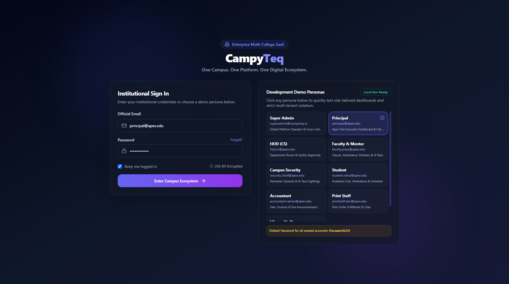
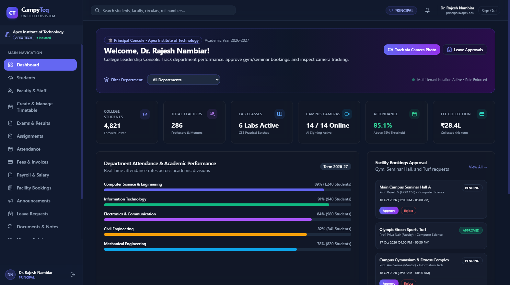
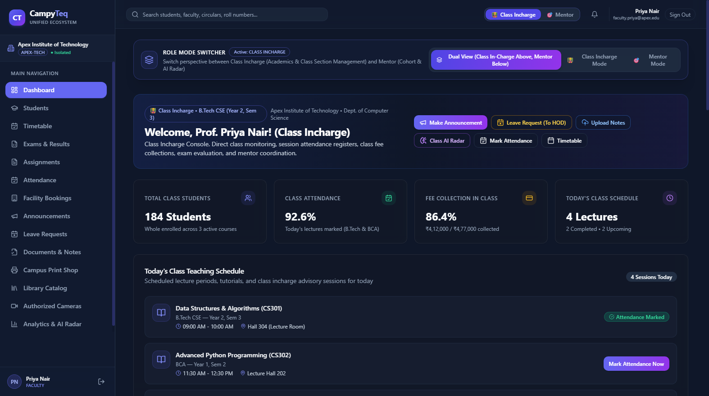
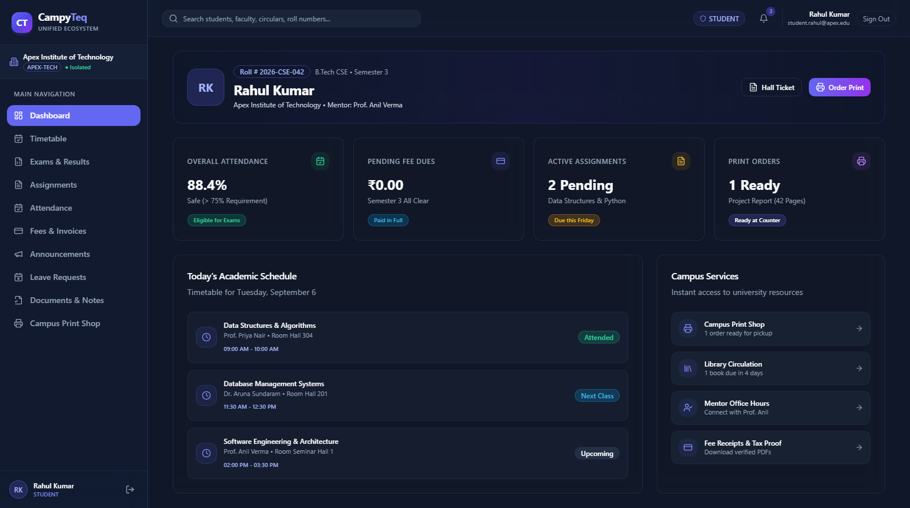
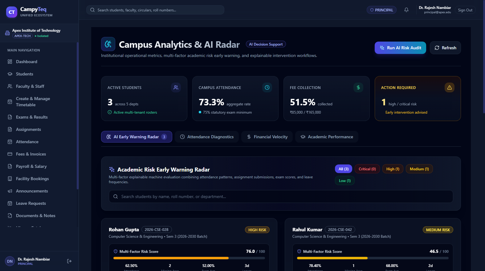
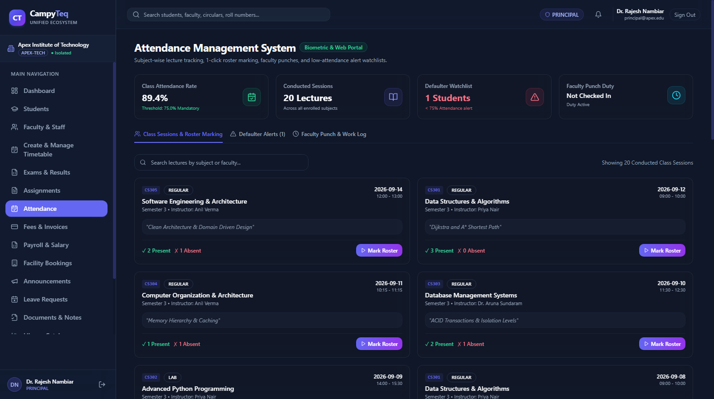
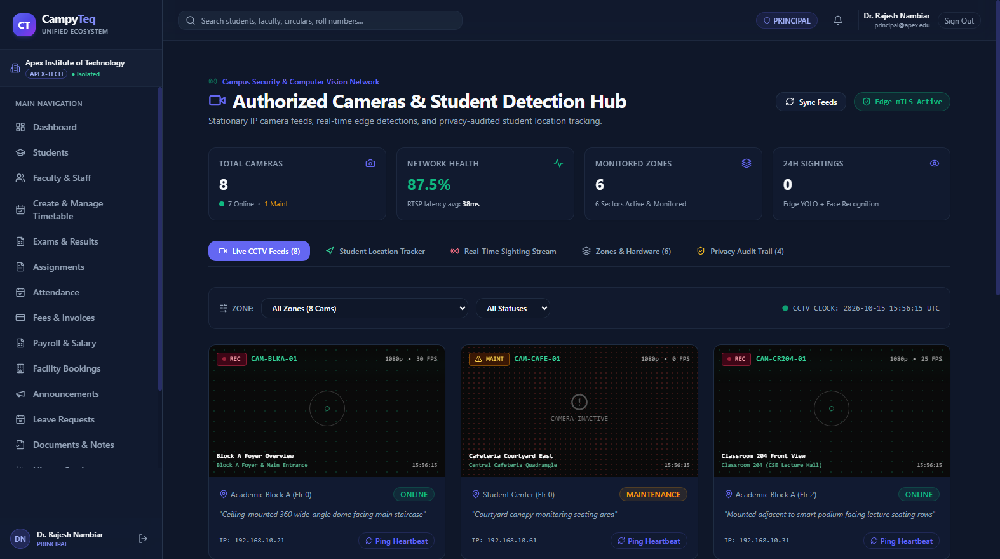
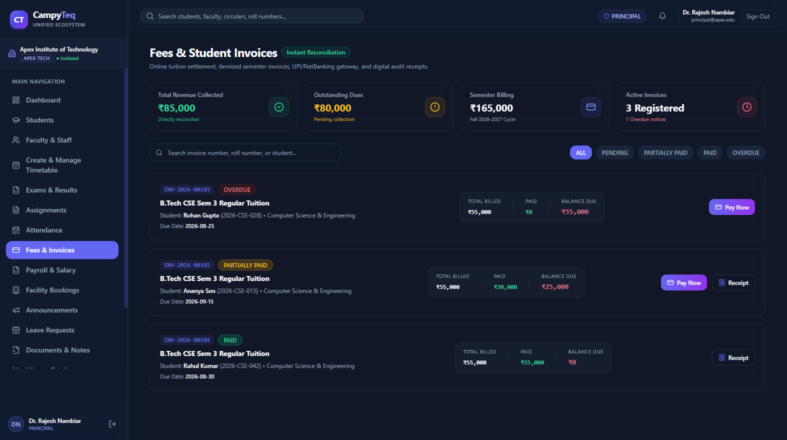
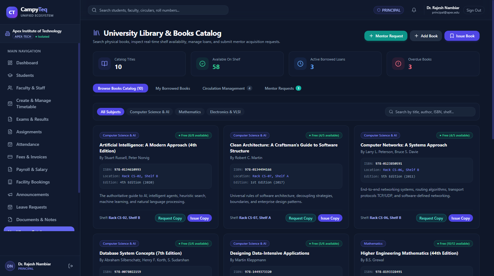
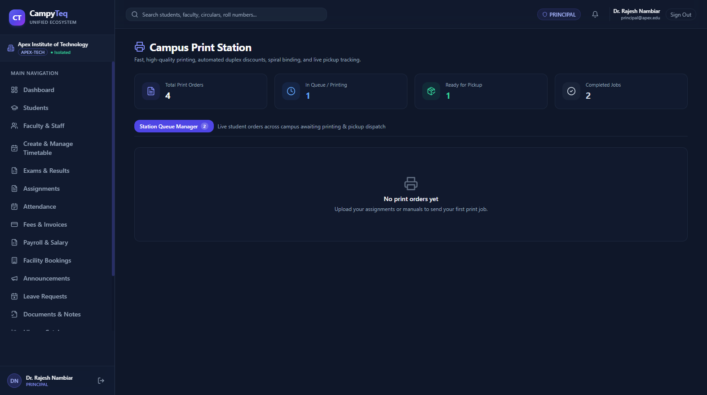

# CampyTeq — Full-Stack Multi-College Digital Ecosystem

> **One Campus. One Platform. One Digital Ecosystem.**

**CampyTeq** is an enterprise-grade, production-quality multi-tenant Higher Education SaaS ecosystem that unifies students, faculty, mentors, HODs, principals, trustees/management, finance officers, library staff, print-shop managers, and campus security forces under strict multi-tenant isolation, granular RBAC, and responsive web & mobile user experiences.

---

## Ecosystem Architecture

```text
campyteq/
├── backend/            # Django 5 REST Framework, SimpleJWT, drf-spectacular, PostgreSQL
│   ├── accounts/       # Custom UUID user, 12 RBAC roles, JWT auth & profile handlers
│   ├── colleges/       # Multi-tenant College model & comprehensive demo seed command
│   ├── departments/    # Academic departments & HOD assignments
│   ├── academics/      # Courses, Batches, Semesters, Subjects, Timetable schedules
│   ├── students/       # Student directory, Guardian details, Mentor assignments
│   ├── faculty/        # Faculty directory, qualifications, subject mappings
│   ├── attendance/     # Lecture/Lab attendance, bulk marking, 75% statutory defaulter radar
│   ├── exams/          # Examination series, exam subjects, confidential grade results
│   ├── assignments/    # Assignments, document attachments, submissions & grading
│   ├── fees/           # Fee structures, student invoices, simulated payment gateway, digital receipts
│   ├── payroll/        # Faculty salary structures, monthly payroll batches, confidential payslips
│   ├── communication/  # Scoped announcements, in-app notifications, mentorship chat threads, official documents, multi-tier leaves
│   ├── printshop/      # Digital print queue manager, cost estimator, kiosk pickup PINs
│   ├── library/        # Digital catalog, book circulation, overdue loan fine manager
│   ├── cameras/        # Campus CCTV registry, camera zones, operational health monitoring
│   ├── tracking/       # Edge CV sighting ingestion, last seen locations, breadcrumb journey stepper, privacy audit logs
│   └── analytics/      # Institutional analytics & AI Academic Early Warning Radar
├── frontend/           # Pure React (Vite), React Router, TypeScript, Tailwind CSS, Lucide icons (20+ routes)
├── cv-service/         # Python Edge Computer Vision & AI detection pipeline (OpenCV / YOLO gateway)
├── DEPLOYMENT.md       # Running instructions manual
└── ARCHITECTURE.md     # Architectural deep-dive & multi-tenancy invariants
```

---

## Visual Tour & System Showcase

### 1. Unified Authentication & 12-Role Persona Switcher
> Instant persona simulation across Super Admin, Principal, HOD, Faculty, Student, Security, Accountant, Print Staff, and Library Staff under strict tenant isolation.



---

### 2. Leadership & Institutional Governance

#### Executive Leadership Console (Principal / Board)
> College-wide operational KPIs, faculty/student rosters, live camera health, statutory attendance metrics, and facility booking approvals.



#### Faculty & Mentor Command Center
> Dual-mode perspective (Class Incharge vs. Cohort Mentor), live lecture schedules, session attendance registers, and student advisory notes.



---

### 3. Student Academic Portal & AI Retention Radar

#### Student Academic Hub
> Today's timetable schedule, 75% examination eligibility gauge, instant hall-ticket downloads, and single-click service shortcuts.



#### Campus Analytics & Explainable AI Early Warning Radar
> Multi-factor predictive student retention engine evaluating attendance drops, missing assignments, exam scores, and leave frequencies.



---

### 4. Operations, Finance & Campus Facilities

#### Lecture Attendance & Statutory 75% Defaulter Radar
> 1-click bulk roster marking, RFID/biometric synchronization, and automated statutory defaulter watchlists.



#### Campus Safety & Edge CV Camera Network
> Stationary RTSP camera registry, live edge AI sighting stream, student journey breadcrumb stepping, and privacy audit logs.



#### Fee Management & Payment Gateway Reconciliation
> Semester tuition invoicing, partial payments, simulated UPI/NetBanking payment modal, and downloadable verified digital receipts.



#### Digital Library & Circulation System
> Real-time physical shelf availability, active borrow tracking, mentor acquisition requests, and automated overdue fine calculations.



#### Campus Fast-Print Station & Kiosk Queue
> High-speed document print queue, automated page and binding cost estimator, and 4-digit kiosk pickup PIN verification.



---

## Implemented Modules (Phases 1 — 10)

| Phase | Module | Key Features | UI Showcase |
|---|---|---|---|
| **Phase 1** | **Multi-Tenant Foundation & RBAC** | Custom `User`, 12 institutional roles, JWT auth, tenant scoping, Swagger/OpenAPI docs, React dark-mode UI. | [View UI](#1-unified-authentication--12-role-persona-switcher) |
| **Phase 2** | **Institutional Hierarchy & People** | Departments (HOD), Courses, Batches, Semesters, Faculty profiles, Student directory, Mentor assignments. | [View UI](#executive-leadership-console-principal--board) |
| **Phase 3** | **Academics, Exams & Assignments** | Subjects, Weekly Timetable, Exam management, confidential results publishing, assignment grading & attachments. | [View UI](#student-academic-hub) |
| **Phase 4** | **Attendance & Faculty Timesheets** | Lecture/lab sessions, bulk student attendance marking, statutory 75% defaulters radar, faculty check-in/out working hours. | [View UI](#lecture-attendance--statutory-75-defaulter-radar) |
| **Phase 5** | **Finance, Fees & Payroll** | Fee structures, student billing invoices, payment gateway simulator, digital receipts, confidential faculty salary payslips. | [View UI](#fee-management--payment-gateway-reconciliation) |
| **Phase 6** | **Communication & Digital Governance** | Audience-scoped circulars, in-app notification drawer, mentorship chat threads, document repository, multi-tier leave workflow. | [View UI](#faculty--mentor-command-center) |
| **Phase 7** | **Print Shop & Digital Library** | Campus fast-print kiosk queue with pickup PINs, digital library catalog, book issues, and ₹5/day overdue fine calculator. | [View UI](#digital-library--circulation-system) |
| **Phase 8** | **Campus Safety & Edge CV Tracking** | Camera registry, simulated video viewports, edge detection ingestion, student last seen & breadcrumb journey stepper, privacy audit log. | [View UI](#campus-safety--edge-cv-camera-network) |
| **Phase 9** | **Analytics & AI Early Warning Radar** | Institutional KPI dashboard, attendance & financial velocity reports, explainable multi-factor AI academic risk engine, mentor counseling workflow. | [View UI](#campus-analytics--explainable-ai-early-warning-radar) |
| **Phase 10** | **Mobile App & Production Deployment** | Cross-platform React Native / Expo student companion app, Gunicorn WSGI, Nginx reverse proxy with rate limiting, Docker Compose production orchestration, GitHub Actions CI/CD. | [View Architecture](#ecosystem-architecture) |

---

## 12 Granular Institutional Roles

1. `SUPER_ADMIN` — System-wide SaaS operator (cross-tenant switcher).
2. `PRINCIPAL` — Chief institutional executive with complete college oversight.
3. `MANAGEMENT` — Board of trustees & executive directors (analytics, finance, compliance).
4. `HOD` — Head of Department (departmental faculty, courses, subjects, students).
5. `MENTOR` — Faculty mentor assigned to a specific cohort of students.
6. `FACULTY` — Course instructor (attendance marking, assignments, timetable).
7. `ACCOUNTANT` — Bursar / finance officer (fees, invoices, payments, payroll).
8. `STUDENT` — Enrolled student (timetable, attendance, grades, fees, print shop, AI radar).
9. `PARENT` — Guardian (student academic records, fee dues, announcements).
10. `SECURITY` — Campus security officer (CCTV status, authorized student sighting lookups with logged justification).
11. `PRINT_STAFF` — Print kiosk operator (queue processing, pickup verification).
12. `LIBRARY_STAFF` — Librarian (catalog, book circulation, overdue fines).

---

## Quick Start (Local Development)

### 1. Backend Setup
```bash
cd backend
python -m venv venv

# Windows PowerShell:
.\venv\Scripts\Activate.ps1
# Linux / macOS:
source venv/bin/activate

pip install -r requirements.txt
python manage.py migrate
python manage.py seed_demo
python manage.py runserver 0.0.0.0:8000
```
- API Root: `http://localhost:8000/api/v1/`
- Interactive OpenAPI Docs: `http://localhost:8000/api/docs/`

### 2. Frontend Setup
```bash
cd frontend
npm install
npm run dev
```
- Web Application: `http://localhost:3000` (features 1-click demo role switcher on login screen).

### 3. Edge Computer Vision / AI Simulation (Python)
```bash
cd cv-service
python stream_simulator.py
```

---

## Automated Verification Suite

Run the full backend test suite:
```bash
cd backend
pytest -v
```

Verify the frontend build:
```bash
cd frontend
npm run build
```

